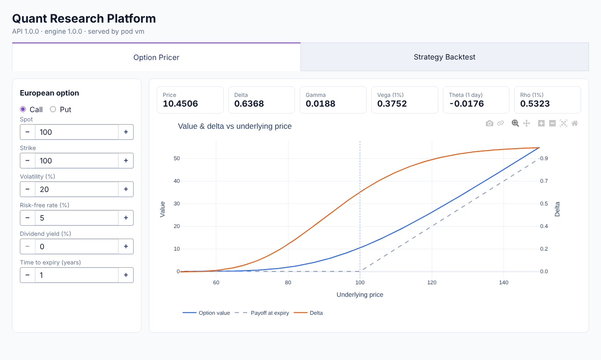

# Quant Research Platform

[](https://github.com/<OWNER>/<REPO>/actions/workflows/ci.yml)
[](https://github.com/<OWNER>/<REPO>/actions/workflows/cd.yml)

A small quantitative research platform. A **C++17 engine** prices European options (Black-Scholes, Greeks, implied volatility), computes risk metrics and backtests trading strategies. It is exposed to Python through **pybind11**, served by **FastAPI** and visualised in a **Dash** dashboard. Everything is containerised with **Docker**, deployed to **Kubernetes (Minikube)**, tested with **GoogleTest + pytest** and automated with **GitHub Actions**.

> Replace `<OWNER>/<REPO>` in the badges above and `<OWNER>` in `.github/CODEOWNERS` with your GitHub account/repository.



```
┌──────────────────┐   HTTP    ┌──────────────────┐  pybind11  ┌──────────────────────┐
│  Dash dashboard  │ ───────►  │   FastAPI (x2)   │ ─────────► │  C++17 quant engine  │
│  NodePort 30050  │           │  ClusterIP 8000  │            │ pricing · stats ·    │
└──────────────────┘           └──────────────────┘            │ backtest · simulate  │
        pod                           pods                     └──────────────────────┘
└───────────────────────── namespace "quant" on Minikube ──────────────────────────────┘
```

---

## Mapping to the learning plan

### Goal 3 — Foundational skills in Software Development Tools

| Plan item | Evidence in this repository |
|---|---|
| **CI/CD pipeline** on a GitHub repository | `.github/workflows/ci.yml`: lint, GoogleTest (GCC + Clang), pytest, Docker build check — runs on every push and PR |
| **Unit testing** with GoogleTest | `engine/tests/`: 43 tests using `TEST`, `TEST_F` and `TEST_P` — Greeks checked against finite differences, put-call parity, implied-vol round trips, no-look-ahead checks. Plus 26 pytest tests for the API and dashboard |
| **Code review** | PR template, `CODEOWNERS`, `CONTRIBUTING.md`, `docs/CODE_REVIEW.md` (branch protection, reviewer checklist, comment conventions), automated clang-format / cppcheck / ruff in CI, Dependabot |
| **Reflection** | `docs/REFLECTION.md` |

### Goal 4 — Docker, Kubernetes, Linux and CI/CD

| Plan item | Evidence in this repository |
|---|---|
| Docker fundamentals | `api/Dockerfile` (multi-stage: build C++ → run GoogleTest → build wheel → slim non-root runtime), `dashboard/Dockerfile`, `docker-compose.yml` |
| Kubernetes basics | `k8s/`: Namespace, ConfigMap, two Deployments (probes, resource limits, rolling updates, read-only root FS), ClusterIP + NodePort Services |
| Containerise the FastAPI + Dash app | `api/` and `dashboard/` |
| Deploy to a local Minikube cluster | `scripts/deploy-minikube.sh` |
| GitHub CI/CD pipeline that builds the Docker image | `.github/workflows/cd.yml`: build → push to GHCR → deploy to Minikube → smoke test → zero-downtime rolling update |
| Linux basics | `docs/LINUX_RUNBOOK.md`, bash scripts in `scripts/`, `Makefile` |

---

## Repository layout

```
engine/                 C++17 library + GoogleTest + pybind11 bindings
  include/quant/        pricing.hpp · stats.hpp · backtest.hpp · simulate.hpp
  src/                  implementation
  tests/                43 GoogleTest unit tests
  bindings/module.cpp   Python module `quant_engine`
api/                    FastAPI service (app/main.py, app/schemas.py) + pytest
dashboard/              Dash UI (app.py, figures.py, api_client.py) + pytest
k8s/                    Kubernetes manifests (kustomize)
scripts/                deploy-minikube.sh · smoke-test.sh
docs/                   CODE_REVIEW.md · LINUX_RUNBOOK.md · REFLECTION.md · screenshots/
.github/                CI/CD workflows · PR template · CODEOWNERS · Dependabot
```

## API

Interactive docs (Swagger UI) at `http://localhost:8000/docs`.

| Method | Endpoint | Description |
|---|---|---|
| GET | `/health`, `/version` | Health check; version and serving pod name |
| POST | `/options/greeks` | Black-Scholes price + Delta, Gamma, Vega, Theta, Rho |
| POST | `/options/implied-vol` | Implied volatility (Newton-Raphson with bisection fallback) |
| POST | `/options/curve` | Price and Greeks across a range of underlying prices (for charts) |
| POST | `/data/simulate` | Seeded Geometric Brownian Motion price path |
| POST | `/analytics/metrics` | Annualised return/volatility, Sharpe, max drawdown, rolling volatility |
| POST | `/backtest/sma-crossover` | SMA crossover backtest with transaction costs and no look-ahead |

Invalid input returns **HTTP 422**: Pydantic validates the request, and errors raised by the C++ engine (`std::invalid_argument` → Python `ValueError`) are mapped to 422 as well.

---

## Getting started

### Requirements
Linux / WSL / macOS with `g++` or `clang++` (C++17), `cmake ≥ 3.18`, `git`, Python ≥ 3.10. Docker, Minikube and kubectl for deployment. Run `make help` to list all shortcuts.

### 1. Test and run locally

```bash
make test-engine                 # build the engine and run GoogleTest
pip install ./engine             # build the pybind11 module
pip install -r api/requirements-dev.txt -r dashboard/requirements-dev.txt
make test-api test-dashboard     # pytest
make run-api                     # terminal 1 → http://localhost:8000/docs
make run-dashboard               # terminal 2 → http://localhost:8050
```

### 2. Docker Compose

```bash
docker compose up --build        # dashboard: http://localhost:8050
```

### 3. Minikube

```bash
./scripts/deploy-minikube.sh     # build → load → apply → rollout → smoke test
minikube service quant-dashboard -n quant
```

### 4. Push to GitHub

```bash
git init && git add . && git commit -m "feat: initial quant research platform"
git branch -M main
git remote add origin https://github.com/<OWNER>/<REPO>.git
git push -u origin main
```

After the push, CI runs; once it is green, CD builds both images, pushes them to GHCR and deploys them to a Minikube cluster inside GitHub Actions. Then **enable branch protection** (`docs/CODE_REVIEW.md` §2) and make further changes through reviewed pull requests.

---

## Evidence screenshots to capture

Save them under `docs/screenshots/`.

| # | Screenshot | Goal | Where |
|---|---|---|---|
| 1 | Green CI run (all jobs) | 3 | Actions → CI |
| 2 | GoogleTest results | 3 | CI run → *GoogleTest (gcc)* check, or terminal `make test-engine` |
| 3 | PR with review comments and green checks | 3 | Pull requests (see `docs/CODE_REVIEW.md` §5) |
| 4 | Branch protection rule | 3 | Settings → Branches |
| 5 | `kubectl get ...` after deploying | 4 | Step 5 of `deploy-minikube.sh` |
| 6 | Dashboard running on Minikube | 4 | `minikube service quant-dashboard -n quant` (header shows the pod name) |
| 7 | Minikube dashboard | 4 | `minikube dashboard` → namespace `quant` |
| 8 | CD run and job summary | 4 | Actions → CD → *Deploy to Minikube* |
| 9 | Images in GHCR | 4 | Repository page → Packages |

---

## Design decisions

- **Quant logic lives in C++; the API is a thin layer.** The engine is tested in isolation with GoogleTest, which keeps the tests fast and independent of HTTP.
- **No look-ahead bias:** the signal at day *t−1* decides the position on day *t*, and a dedicated test enforces it.
- **Synthetic, seeded data (GBM)** keeps results reproducible and avoids external data dependencies. Real data can be used directly: the analytics and backtest endpoints accept any price series.
- **Container hardening:** multi-stage builds (no compiler in runtime images), non-root users, `readOnlyRootFilesystem`, all Linux capabilities dropped.
- **Stateless API** scales horizontally (2 replicas behind a ClusterIP Service); `maxUnavailable: 0` gives zero-downtime rolling updates.

## Possible extensions

Real market data (CSV/Parquet), persisting backtests in PostgreSQL, Monte Carlo pricing for American options, a Helm chart, Prometheus + Grafana, code coverage (gcovr) in CI.
